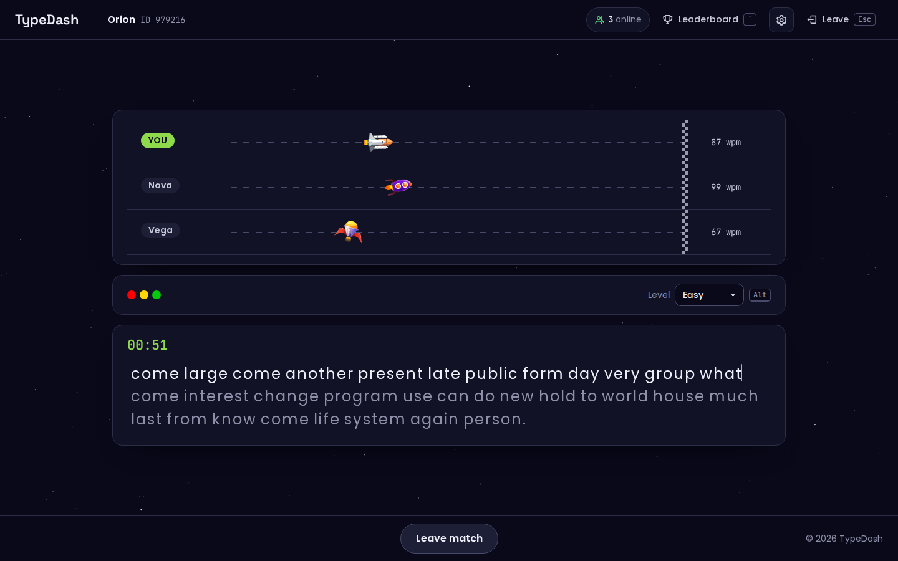
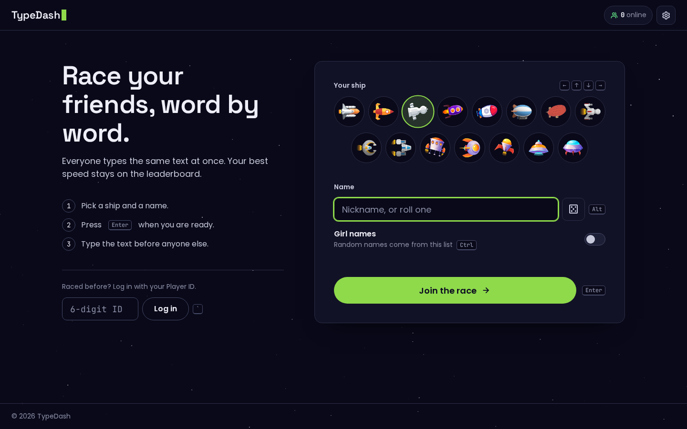
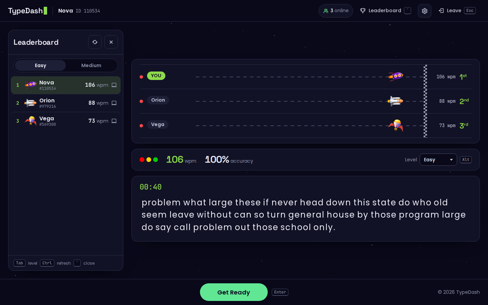
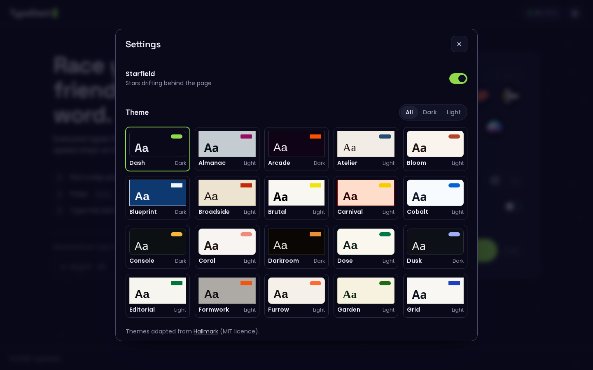
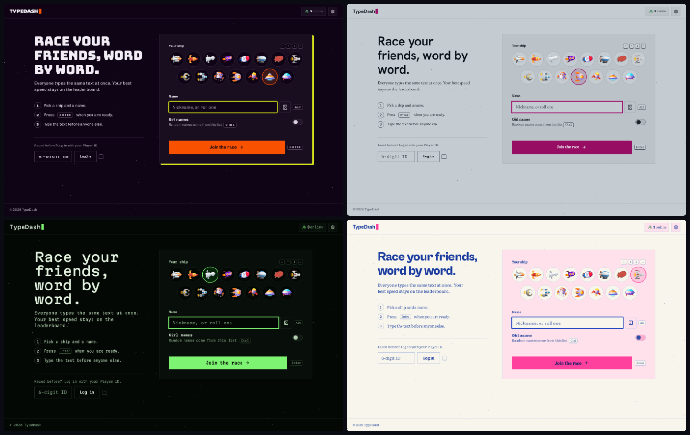
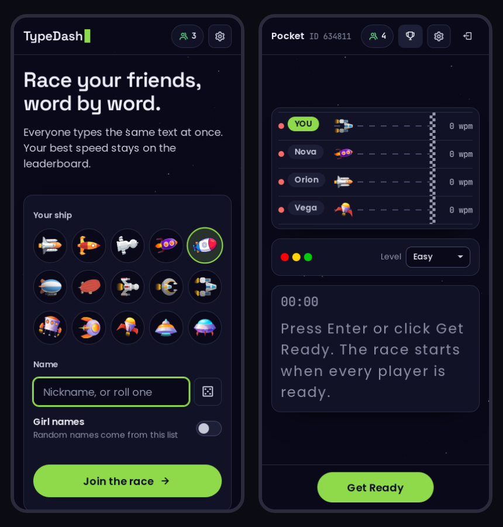

<div align="center">
  <a href="https://typedash-81ar.onrender.com">
    
  </a>

  <h3 align="center">Type Dash</h3>

  <p align="center">
    A real-time multiplayer typing race, built for running live typing competitions at exhibitions, college fests and events.
    <br />
    <br />
    <a href="https://typedash-81ar.onrender.com"><strong>Live demo</strong></a>
    ·
    <a href="https://youtu.be/lEh0KG50AsI?si=DnHKlQqClXtbN8BN">Video walkthrough</a>
    ·
    <a href="https://www.figma.com/design/PLxbmlfXFbZ33MHcqdyLHC/Type-Dash?node-id=0-1&t=BZFaK7r2I1Tiyvcj-1">Figma designs</a>
    ·
    <a href="https://github.com/anisharma07/TypeDash/issues">Report a bug</a>
  </p>

  <p align="center">
    
    
    
    
    
  </p>
</div>



> The live demo runs on a free Render instance and can take a minute to wake up on the first visit.

## Overview

Type Dash puts every connected player on the same space-themed race track. Everyone types the same text, and each
player's ship moves forward as they type, with WPM updating live for all players. When the race ends, each player
sees their WPM and accuracy, and their best score goes on a persistent leaderboard.

It works for a quick 1v1, and also for running a whole event. Players register once and get a 6-digit Player ID.
They can come back with that ID for as many races as they like, and the leaderboard keeps each player's best WPM.
Organisers can then hand out prizes from the final standings.

## Screenshots

<table>
  <tr>
    <td width="50%"></td>
    <td width="50%"></td>
  </tr>
  <tr>
    <td align="center"><b>Join</b>: pick a ship and a name, or log in with your Player ID</td>
    <td align="center"><b>Results</b>: WPM, accuracy, places and the leaderboard</td>
  </tr>
  <tr>
    <td width="50%"></td>
    <td width="50%"></td>
  </tr>
  <tr>
    <td align="center"><b>Settings</b>: 49 themes, filtered by dark or light</td>
    <td align="center"><b>Themes</b>: Arcade, Almanac, Terminal, Riso</td>
  </tr>
</table>

<p align="center">
  
  <br>
  <b>Phones</b>: the whole game works on a 320 px wide screen and up
</p>

## Features

- **Live races.** Any number of players race on one shared track, with ship positions and WPM updated in real time over Socket.IO.
- **Persistent leaderboard.** Best WPM is stored per player in MongoDB, separately for each difficulty and for mobile vs laptop.
- **Quick sign-up.** Pick a name (or roll a random one) and a ship, and get a reusable 6-digit Player ID.
- **Two difficulty levels.** Easy is 33 random words. Medium is a full quote with punctuation.
- **Live player count.** Both pages show how many players are in the game right now.
- **49 themes.** Switch the whole look from the settings dialog; the choice is remembered and shared across open tabs.
- **Traffic-light countdown.** A short countdown starts the race once everyone is ready.
- **Results screen.** Each player sees WPM, accuracy and their place after every race.
- **Keyboard-only play.** Every action has a shortcut, so an event can run without anyone touching a mouse.
- **Works on phones.** Layouts are tested from 320 px wide up to desktop.
- **Hard to break.** The server ignores bad or out-of-order messages and keeps running if the database goes down.
  Scores only count from a race, once per race, and up to 400 WPM.

## How a race works

1. **Join.** On the home page, enter a username (3 to 10 characters) or roll a random one, and pick a ship. You get a
   6-digit **Player ID**. Returning players type their ID into the log-in box instead of registering again.
2. **Pick a difficulty.** Each player picks Easy or Medium. When the race starts, the majority choice wins, and a tie goes to Easy.
3. **Ready up.** Press <kbd>Enter</kbd> to mark yourself ready. The race starts once **every** connected player is
   ready, and it needs at least two players.
4. **Race.** Wait for the countdown, then type. A word only moves on once it is typed correctly, so fix mistakes with
   <kbd>Backspace</kbd>. Everyone's progress and WPM update live on the track.
5. **Results.** You see your WPM and accuracy. If it's a personal best for that difficulty and device type, the leaderboard updates.

All players connected to a server share one lobby, so only one race runs at a time per server.

## Keyboard shortcuts

**Home page**

| Key | Action |
| --- | --- |
| <kbd>Alt</kbd> | Roll a random username |
| <kbd>Ctrl</kbd> | Switch between the boy and girl name lists |
| Arrow keys | Choose a ship |
| <kbd>`</kbd> | Jump to the Player ID box (returning players) |
| <kbd>Enter</kbd> | Join the race |

**Race lobby**

| Key | Action |
| --- | --- |
| <kbd>Enter</kbd> | Ready / not ready |
| <kbd>Alt</kbd> | Switch difficulty |
| <kbd>`</kbd> | Show / hide the leaderboard |
| <kbd>Tab</kbd> | Switch the leaderboard between Easy and Medium |
| <kbd>Ctrl</kbd> | Refresh the leaderboard |
| <kbd>Esc</kbd> | Leave the game |

In the settings dialog, <kbd>Esc</kbd> closes it and the arrow keys move through the themes. Lobby keys are switched off during a race.

## Tech stack

| Layer | Technology | Used for |
| --- | --- | --- |
| **Frontend** |   | Home and game pages, typing engine, race state |
| **Build** |  | Dev server with hot reload, production build into `client/dist` |
| **Styling** |   | Theme tokens ([Hallmark](https://github.com/Nutlope/hallmark) themes, MIT), icons |
| **Animation** |  | Starfield background |
| **Server** |   | Serves the app and the leaderboard API |
| **Realtime** |  | Lobby, ready status, race start, live progress and ranks |
| **Database** |   | Players, Player IDs and high scores |
| **Unit tests** |   | Typing engine, game rules and components (278 tests) |
| **UI tests** |  | Real browsers against the real server (126 tests) |
| **Deploy** |   | Docker Compose with a local MongoDB; the live demo runs on Render |
| **Design** |   | Screens and ship artwork |

A single Node.js server (Express + Socket.IO) handles the live race state and stores players and high scores in
MongoDB with Mongoose. The frontend is a React + TypeScript app built with Vite. In production the server serves the
built files from `client/dist`.

```
TypeDash/
├── app.js            # Express + Socket.IO server; serves client/dist
├── utils/            # Player state, MongoDB model, quotes and random names
├── client/           # React + TypeScript + Vite frontend (home page and game page)
│   ├── src/          # Components, typing engine, themes, typed socket protocol, unit tests
│   └── e2e/          # Playwright UI tests and the README screenshot script
├── e2e/support/      # Test server launcher and in-memory database
├── docs/             # Screenshots, roadmap (docs/plan) and deployment notes (docs/ops)
├── legacy/public/    # Original vanilla HTML/CSS/JS frontend (reference only)
└── docker-compose.yml
```

## Getting started

### Option 1: Docker (recommended)

You need Docker with the Compose plugin (`docker compose`). This builds the app and starts it together with a local MongoDB container:

```bash
git clone https://github.com/anisharma07/TypeDash
cd TypeDash
docker compose --profile local-db up --build -V -d
```

Open **http://localhost:2360**. Other devices on the same network can join at `http://<your-ip>:2360`.

| Task | Command |
| --- | --- |
| View logs | `docker compose --profile local-db logs -f` |
| Stop | `docker compose --profile local-db down` |
| Rebuild after code changes | `docker compose --profile local-db up --build -V -d` |

You can also use the helper scripts, which wrap these commands and check that the app and database respond:
`./scripts/start.sh`, `./scripts/status.sh` and `./scripts/stop.sh`. If a `.env` with an Atlas URI exists, `start.sh`
uses Atlas, and `./scripts/start.sh --setup` asks which database to use.

Leaderboard data lives in the `mongo-data` Docker volume, so it survives restarts and rebuilds. Don't run `down -v`
unless you mean to delete it.

**Using MongoDB Atlas instead.** Put your connection string in a `.env` file and start the `atlas` profile, which runs the app without the local database:

```bash
echo 'MONGODB_URI=mongodb+srv://<user>:<password>@<cluster>.mongodb.net/TypeDash' > .env
docker compose --profile atlas up --build -V -d
```

> **Hosting on shared Wi-Fi?** `docker-compose.yml` publishes the local MongoDB on port `2701` of every network
> interface, and it has no password. The app doesn't need that port, because it reaches the database over Docker's
> internal network. To keep the database private, change the mongo port mapping to `"127.0.0.1:2701:27017"`.

> **Running Node.js after Docker?** The compose file mounts the project folder, and Docker can leave empty,
> root-owned `node_modules` and `client/dist` folders behind. If `npm install` or `npm run build` fails with
> `EACCES`, remove them once with `sudo rm -rf node_modules client/dist`.

[DOCKER_INSTRUCTIONS.md](DOCKER_INSTRUCTIONS.md) explains how the image is built and how to clean up old volumes.

### Option 2: Run with Node.js

You need Node.js **22.13+, 24, or 26+** (Node 23 isn't supported by the test runner) and MongoDB, either local or Atlas.

```bash
git clone https://github.com/anisharma07/TypeDash
cd TypeDash

npm install          # server dependencies
npm run build        # install and build the React client into client/dist

echo 'MONGODB_URI=mongodb://localhost:27017/TypeDash' > .env
npm start            # http://localhost:2360
```

See [DEVSETUP.md](DEVSETUP.md) for platform-specific MongoDB setup and troubleshooting.

### Development

Run the server and the Vite dev server in two terminals:

```bash
npm run dev          # Node server with auto-reload on :2360
npm run client:dev   # Vite dev server with hot reload on :5173, proxies to :2360
```

Open http://localhost:5173 while developing.

## Testing

| Command | What it runs | Time |
| --- | --- | --- |
| `npm test` | Unit tests (Vitest, jsdom) | ~10 s |
| `npm run e2e` | UI tests (Playwright) against the real server with an in-memory database, no MongoDB needed | ~2 min |
| `npm --prefix client run typecheck` | TypeScript for the app and the tests | ~5 s |
| `npm run screenshots` | Regenerates the screenshots in this README | ~2 min |

Before the first UI test run, install the client packages and Playwright's browser:
`npm --prefix client install && npm --prefix client run e2e:install`.

The UI tests cover the home page, the lobby, full races between several browsers, the settings and all 49 themes,
and five screen widths from 320 px. A server test also sends malformed and out-of-order messages to every
socket event. Each test fails if the server crashes or logs an error, or if a page throws one.
[client/e2e/README.md](client/e2e/README.md) lists what each file covers.

## Configuration

| Variable | Where | Default | Purpose |
| --- | --- | --- | --- |
| `MONGODB_URI` | `.env` or environment | `mongodb://mongo:27017/TypeDash` in Docker | MongoDB connection string (required outside Docker) |
| `PORT` | process environment only | `2360` | Server port, e.g. `PORT=3000 npm start`. Not read from `.env`. |
| `TYPEDASH_SERVER` | process environment | `http://localhost:2360` | Where the Vite dev server proxies to, if the server isn't on 2360 |
| `CLIENT_DIST` | process environment | `client/dist` | Serve a client build from another folder (the UI tests use this) |

## Hosting a live event

- **Same network.** Run Type Dash on one machine and share `http://<that-machine's-ip>:2360` with players on the same
  Wi-Fi. The server logs its network address when it starts.
- **Over the internet, temporarily.** Use a tunnel such as [ngrok](https://ngrok.com) (`ngrok http 2360`) and share the link it gives you.
- **Permanently.** Deploy to any host that runs Docker or Node.js, such as Render, Railway or a VPS.
  [docs/ops/railway.md](docs/ops/railway.md) has Railway notes.

## Contributing

Bug reports and pull requests are welcome. For anything bigger than a small fix, please
[open an issue](https://github.com/anisharma07/TypeDash/issues) first so we can talk it through. Before you open a
PR, make sure `npm test` and `npm run e2e` pass and `npm --prefix client run typecheck` is clean. If your change adds
or alters something players can see or do, add or update a Playwright test for it.

## License

Released under the [MIT License](LICENSE).
