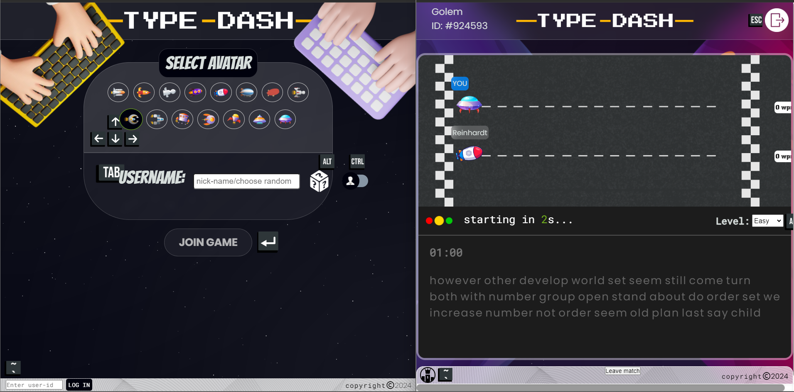

<div align="center">
  <a href="https://typedash-81ar.onrender.com">
    
  </a>

  <h3 align="center">Type Dash</h3>

  <p align="center">
    A real-time multiplayer typing race, built for running live typing competitions at exhibitions, college fests and events.
    <br />
    <br />
    <a href="https://typedash-81ar.onrender.com"><strong>Live demo</strong></a>
    ·
    <a href="https://youtu.be/lEh0KG50AsI?si=DnHKlQqClXtbN8BN">Video walkthrough</a>
    ·
    <a href="https://www.figma.com/design/PLxbmlfXFbZ33MHcqdyLHC/Type-Dash?node-id=0-1&t=BZFaK7r2I1Tiyvcj-1">Figma designs</a>
    ·
    <a href="https://github.com/anisharma07/TypeDash/issues">Report a bug</a>
  </p>
</div>



> The live demo runs on a free Render instance and can take a minute to wake up on the first visit.

## About

Type Dash puts every connected player on the same space-themed race track. Everyone types the same text, and each
player's avatar moves forward as they type, with WPM updating live for all players. When the race ends, each player
sees their WPM and accuracy, and their best score goes on a persistent leaderboard.

It works for a quick 1v1, and also for running a whole event. Players register once and get a 6-digit Player ID.
They can come back with that ID for as many races as they like, and the leaderboard keeps each player's best WPM.
Organisers can then hand out prizes from the final standings.

## Features

- **Live races.** Any number of players race on one shared track, with avatar positions and WPM updated in real time over Socket.IO.
- **Persistent leaderboard.** Best WPM is stored per player in MongoDB, separately for each difficulty and for mobile vs laptop.
- **Quick sign-up.** Pick a name (or roll a random one) and an avatar, and get a reusable 6-digit Player ID.
- **Two difficulty levels.** Easy is 33 random words. Medium is a full quote with punctuation.
- **Traffic-light countdown.** A short countdown starts the race once everyone is ready.
- **Results screen.** Each player sees WPM and accuracy after every race.
- **Keyboard-only play.** Every action has a shortcut, so an event can run without anyone touching a mouse.
- **Space theme.** Animated particle starfield backgrounds built with tsParticles.

## How a race works

1. **Join.** On the home page, enter a username (up to 10 characters) or roll a random one, pick an avatar, and add a
   name or contact so organisers can reach winners. You get a 6-digit **Player ID**. Returning players type their
   ID into the join box instead of registering again.
2. **Pick a difficulty.** Each player picks Easy or Medium. When the race starts, the majority choice wins, and a tie goes to Easy.
3. **Ready up.** Press <kbd>Enter</kbd> to mark yourself ready. The race starts once **every** connected player is
   ready, and it needs at least two players.
4. **Race.** Wait for the traffic light, then type. Everyone's progress and WPM update live on the track.
5. **Results.** You see your WPM and accuracy. If it's a personal best for that difficulty and device type, the leaderboard updates.

All players connected to a server share one lobby, so only one race runs at a time per server.

## Keyboard shortcuts

**Home page**

| Key | Action |
| --- | --- |
| <kbd>Alt</kbd> | Roll a random username |
| <kbd>Ctrl</kbd> | Switch between the two avatar sets |
| Arrow keys | Choose an avatar |
| <kbd>Tab</kbd> | Switch between the username and contact fields |
| <kbd>`</kbd> | Jump to the Player ID box (returning players) |

**Race lobby**

| Key | Action |
| --- | --- |
| <kbd>Enter</kbd> | Ready / not ready |
| <kbd>Alt</kbd> | Switch difficulty |
| <kbd>`</kbd> | Show / hide the leaderboard |
| <kbd>Tab</kbd> | Switch the leaderboard between Easy and Medium |
| <kbd>Ctrl</kbd> | Refresh the leaderboard |
| <kbd>Esc</kbd> | Leave the game |

## Getting started

### Option 1: Docker (recommended)

You need Docker with the Compose plugin (`docker compose`). This builds the app and starts it together with a local MongoDB container:

```bash
git clone https://github.com/anisharma07/TypeDash
cd TypeDash
docker compose --profile local-db up --build -V -d
```

Open **http://localhost:2360**. Other devices on the same network can join at `http://<your-ip>:2360`.

| Task | Command |
| --- | --- |
| View logs | `docker compose --profile local-db logs -f` |
| Stop | `docker compose --profile local-db down` |
| Rebuild after code changes | `docker compose --profile local-db up --build -V -d` |

You can also use the helper scripts, which wrap these commands and check that the app and database respond:
`./scripts/start.sh`, `./scripts/status.sh` and `./scripts/stop.sh`. If a `.env` with an Atlas URI exists, `start.sh`
uses Atlas, and `./scripts/start.sh --setup` asks which database to use.

Leaderboard data lives in the `mongo-data` Docker volume, so it survives restarts and rebuilds. Don't run `down -v`
unless you mean to delete it.

**Using MongoDB Atlas instead.** Put your connection string in a `.env` file and start the `atlas` profile, which runs the app without the local database:

```bash
echo 'MONGODB_URI=mongodb+srv://<user>:<password>@<cluster>.mongodb.net/TypeDash' > .env
docker compose --profile atlas up --build -V -d
```

> **Hosting on shared Wi-Fi?** `docker-compose.yml` publishes the local MongoDB on port `2701` of every network
> interface, and it has no password. The app doesn't need that port, because it reaches the database over Docker's
> internal network. To keep the database private, change the mongo port mapping to `"127.0.0.1:2701:27017"`.

[DOCKER_INSTRUCTIONS.md](DOCKER_INSTRUCTIONS.md) explains how the image is built and how to clean up old volumes.

### Option 2: Run with Node.js

You need Node.js **22.13+, 24, or 26+** (Node 23 isn't supported by the test runner) and MongoDB, either local or Atlas.

```bash
git clone https://github.com/anisharma07/TypeDash
cd TypeDash

npm install          # server dependencies
npm run build        # install and build the React client into client/dist

echo 'MONGODB_URI=mongodb://localhost:27017/TypeDash' > .env
npm start            # http://localhost:2360
```

See [DEVSETUP.md](DEVSETUP.md) for platform-specific MongoDB setup and troubleshooting.

### Development

Run the server and the Vite dev server in two terminals:

```bash
npm run dev          # Node server with auto-reload on :2360
npm run client:dev   # Vite dev server with hot reload on :5173, proxies to :2360
```

Open http://localhost:5173 while developing. Run the client test suite (Vitest) with:

```bash
npm test
```

## Configuration

| Variable | Where | Default | Purpose |
| --- | --- | --- | --- |
| `MONGODB_URI` | `.env` or environment | `mongodb://mongo:27017/TypeDash` in Docker | MongoDB connection string (required outside Docker) |
| `PORT` | process environment only | `2360` | Server port, e.g. `PORT=3000 npm start`. Not read from `.env`. |
| `TYPEDASH_SERVER` | process environment | `http://localhost:2360` | Where the Vite dev server proxies to, if the server isn't on 2360 |

## Hosting a live event

- **Same network.** Run Type Dash on one machine and share `http://<that-machine's-ip>:2360` with players on the same
  Wi-Fi. The server logs its network address when it starts.
- **Over the internet, temporarily.** Use a tunnel such as [ngrok](https://ngrok.com) (`ngrok http 2360`) and share the link it gives you.
- **Permanently.** Deploy to any host that runs Docker or Node.js, such as Render, Railway or a VPS.
  [docs/ops/railway.md](docs/ops/railway.md) has Railway notes.
- **Display tip.** The UI is designed for large screens. If it looks cramped, zoom out with <kbd>Ctrl</kbd> <kbd>-</kbd>.

## Tech stack


A single Node.js server (Express + Socket.IO) handles the live race state and stores players and high scores in
MongoDB with Mongoose. The frontend is a React + TypeScript app built with Vite. In production the server serves the
built files from `client/dist`.

```
TypeDash/
├── app.js            # Express + Socket.IO server; serves client/dist
├── utils/            # Player state, MongoDB model, quotes and random names
├── client/           # React + TypeScript + Vite frontend (home page and game page)
│   └── src/          # Components, typing engine, typed socket protocol, tests
├── legacy/public/    # Original vanilla HTML/CSS/JS frontend (reference only)
├── docs/             # Roadmap (docs/plan) and deployment notes (docs/ops)
└── docker-compose.yml
```

## Contributing

Bug reports and pull requests are welcome. For anything bigger than a small fix, please
[open an issue](https://github.com/anisharma07/TypeDash/issues) first so we can talk it through. Before you open a
PR, make sure `npm test` passes and `npm --prefix client run typecheck` is clean.

## License

Released under the [MIT License](LICENSE).
